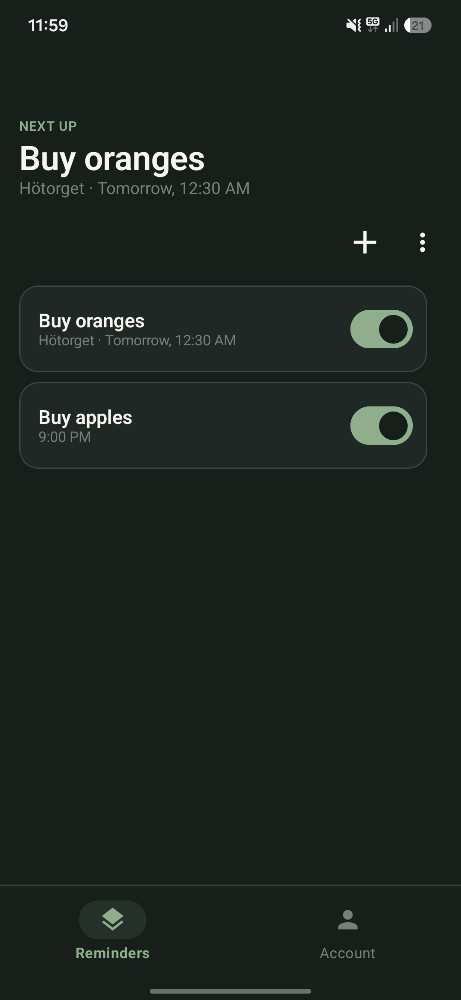
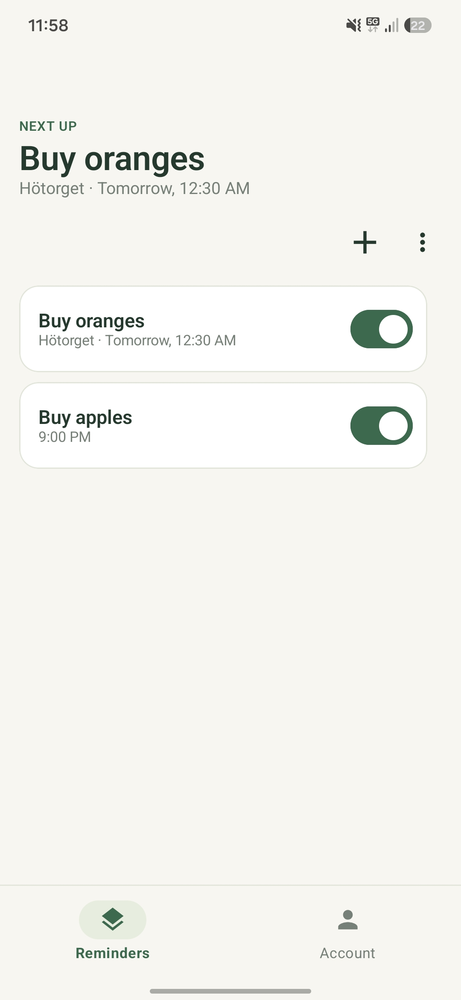
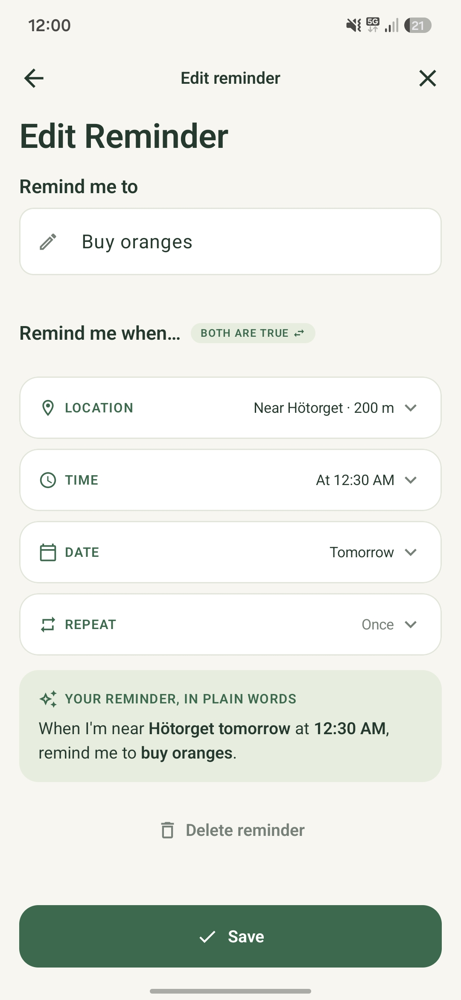
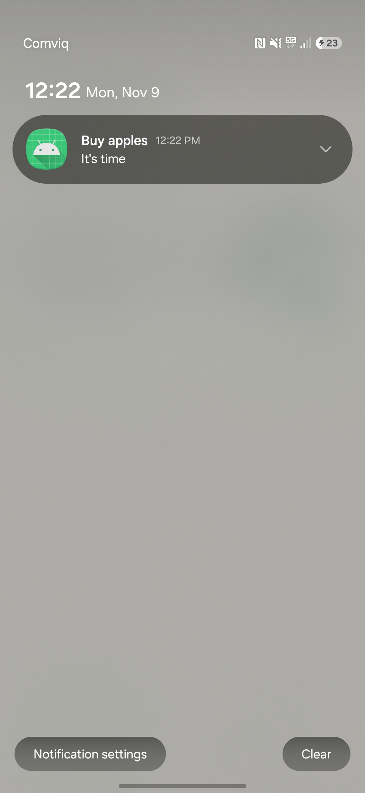
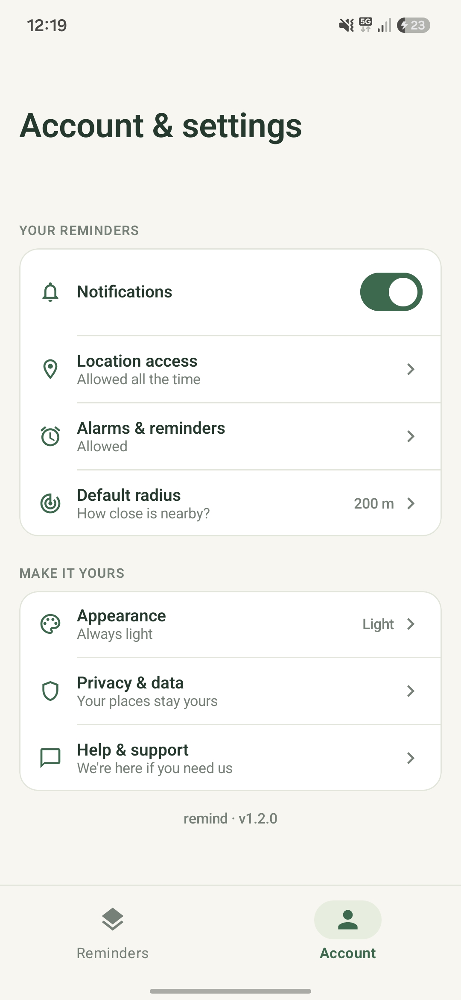

<p align="center">
  <h1 align="center">RemindMe</h1>
  <p align="center">
    Reminders that know <b>where</b> you are, not just what time it is.
  </p>
  <p align="center">
    <a href="https://github.com/DanOzb/RemindMe/actions/workflows/build.yml"></a>
    
    
    <a href="LICENSE"></a>
  </p>
</p>

<p align="center">
  
  &nbsp;&nbsp;
  
</p>

RemindMe is an Android app for reminders that fire when you **arrive at or leave a place**, at a **time or date**, on a **repeat schedule**, or any mix of these. While you set one up, the app writes your rule out as a plain sentence, so you always know exactly when it will go off.

> *e.g. "Every Monday, when I'm near Hötorget at 09:00."*

## 🎬 Demo


<div align="center">
  <video src="https://github.com/user-attachments/assets/4f8c024c-e5b7-46c0-baea-9aeeb22c11ab" width="300" controls></video>
</div>


## ✨ Features

- **📍 Location reminders** – get reminded when you're *near* a place or *away from* it, once or every time.
- **⏰ Time and date** – one-off reminders or a specific time of day.
- **🔁 Flexible repeats** – daily, weekly, or a custom schedule.
- **🧩 Combine triggers** – place *and* time, or place *or* time.
- **💬 Plain-language summary** – the rule you're building is written out as a sentence that updates as you go.
- **✅ Mark done from the notification** – no need to open the app.
- **🟢 Nearby indicator** – see at a glance which reminders are close by.
- **🌗 Light and dark theme** – follows your phone, or pick one yourself.
- **🔒 Stays on your phone** – reminders are stored locally on your device.

## 📸 Screenshots

<!-- Change the captions to match what each screenshot shows. Remove a cell if you don't have that shot. -->
<table>
  <tr>
    <td align="center" width="33%">
      <br />
      <sub><b>Create a reminder</b><br />Place, time, date and repeat in one screen</sub>
    </td>
    <td align="center" width="33%">
      <br />
      <sub><b>Get notified</b><br />Mark it done right from the notification</sub>
    </td>
    <td align="center" width="33%">
      <br />
      <sub><b>Make it yours</b><br />Light, dark or system theme</sub>
    </td>
</table>

## 📥 Download

Grab the latest APK from the [**Releases**](https://github.com/DanOzb/RemindMe/releases) page and install it on your phone. You may need to allow installing apps from unknown sources.

> [!NOTE]
> For location reminders to work in the background, allow location access **all the time** and allow notifications when the app asks.

## 🛠️ Built with

| | |
|---|---|
| **Language** | Kotlin |
| **UI** | Jetpack Compose, Material 3 |
| **Storage** | Room |
| **Location** | Google Play services geofencing, Android `Geocoder` for place search |
| **Scheduling** | `AlarmManager` exact alarms, re-registered after reboot |
| **CI** | GitHub Actions (debug APK on every push, signed release APK on version tags) |

<details>
<summary><b>How it works</b></summary>
<br />

- Every reminder is turned into a **trigger plan**: a geofence for the place, an alarm for the time, or both.
- When a geofence or alarm fires, the app checks whether the full rule is met (for example *near the place* **and** *at the right time*) before showing a notification.
- Repeating reminders work out their next due time and schedule themselves again.
- Triggers are restored automatically when the phone restarts.

</details>

## 🚀 Build it yourself

**Requirements:** Android Studio, JDK 17, a device or emulator running Android 7.0 (API 24) or newer.

```bash
git clone https://github.com/DanOzb/RemindMe.git
cd RemindMe
./gradlew assembleDebug
```

The APK ends up in `app/build/outputs/apk/debug/`. Or just open the project in Android Studio and press **Run**.

Run the unit tests with:

```bash
./gradlew test
```

> [!TIP]
> Place search uses Google Play services. On an emulator, pick a system image **with Google Play**. To test location reminders, open the emulator's **Extended controls → Location** and move the pin into or out of the place.

## 🗺️ Next ideas

- [ ] Suggest places from earlier reminders
- [ ] Saved places and pins (Home, Work, favorite shop)
- [ ] Map view for picking a spot

## 📄 License

Released under the [MIT License](LICENSE).
